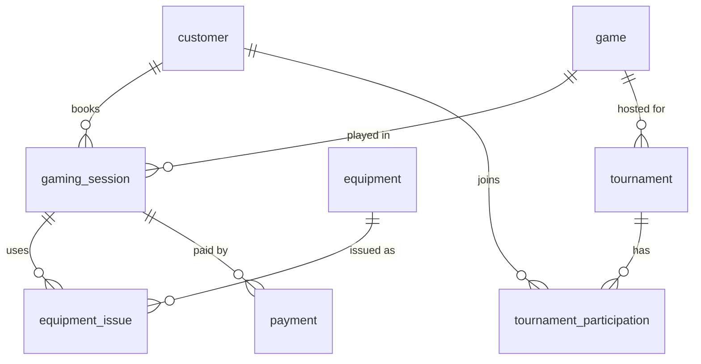

# 🎮 Indoor Gaming Arena

A full-stack management system for an indoor gaming arena offering **bowling, VR gaming, snooker, arcade games and laser tag**.
Customers reserve sessions, equipment is issued and returned, tournaments are organised and scored, and payments are recorded.

| Layer     | Tech                                                          |
|-----------|---------------------------------------------------------------|
| Database  | **MySQL 8** (schema modelled in MySQL Workbench → `database/`) |
| Backend   | **Python 3.10+**, Flask, PyMySQL (parameterised queries, transactions), Waitress |
| Frontend  | Dependency-free single-page app (HTML + CSS + vanilla JS, no build step) |
| DevOps    | Docker, Docker Compose, GitHub Actions (CI + image publishing to GHCR) |

## Features

- **Dashboard** – revenue, today's sessions, pending payments, equipment status, revenue by game
- **Sessions** – book / reschedule / start / complete / cancel with rules enforced server-side:
  opening hours, no past bookings, no overlapping live sessions for the same customer, auto-calculated end time
- **Equipment** – inventory, issue & return (atomic and row-locked so one item can't be issued twice), "damaged → maintenance" flow
- **Payments** – record Cash / Card / UPI / Wallet payments, default to the outstanding balance, settle pending, refund
- **Tournaments** – create, register players, record scores, compute ranks (ties share a rank: 1-2-2-4), prize pool
- **Customers & Games** – CRUD, search, history view, pricing
- Optional **API key** protecting all write operations

## Database design

`database/schema.sql` follows the Workbench model `database/indoorgamingarena.mwb` (8 tables, 8 foreign keys).



Small additions on top of the `.mwb` (all in `schema.sql`; nothing is renamed): `AUTO_INCREMENT` keys, `NOT NULL DEFAULT` on status columns,
`CHECK` constraints (no negative prices), indexes, `UNIQUE (tournament_id, customer_id)`, `UNIQUE` customer email / game name, and explicit `ON DELETE` rules
(financial and session records are `RESTRICT`ed; tournament participants `CASCADE`). The column `rankk` keeps its original spelling (RANK is a reserved word).

## Quick start (Windows, macOS or Linux)

You need **Python 3.10+** and **MySQL 8** running. Open the project folder in VS Code and use its terminal (**Ctrl + `**).
First check you're in the right folder: `dir` (Windows) or `ls` should list `run.py` and `requirements.txt`.

```powershell
# 1. (recommended) create a virtual environment
python -m venv venv
venv\Scripts\activate            # macOS/Linux: source venv/bin/activate

# 2. install dependencies
pip install -r requirements.txt

# 3. configure the database connection
copy .env.example .env           # macOS/Linux: cp .env.example .env
#    then open .env and set DB_USER / DB_PASSWORD to your MySQL login

# 4. create the tables + demo data (runs database/schema.sql and seed.sql)
python init_db.py

# 5. start the server
python run.py                    # → http://localhost:3000
```

Notes:
- **`python` not found on Windows?** Try `py` instead of `python`.
- **PowerShell blocks `activate`?** Run `Set-ExecutionPolicy -Scope CurrentUser RemoteSigned` once, or skip the virtual environment and just run `pip install -r requirements.txt`.
- Prefer a GUI? Instead of step 4, open `database/schema.sql` and then `database/seed.sql` in **MySQL Workbench** and run them.
- `init_db.py` **drops and recreates** the tables, so only run it on a fresh database.

### Or with Docker (no Python/MySQL install needed)

```bash
docker compose up --build        # → http://localhost:3000
```
MySQL starts first, loads `schema.sql` + `seed.sql` on the first run, then the app starts.

### Run the tests

```bash
pip install -r requirements-dev.txt
pytest -q                        # needs the database from step 4
```

## Configuration (`.env`)

| Variable | Default | Purpose |
|----------|---------|---------|
| `PORT` | `3000` | HTTP port |
| `DB_HOST` `DB_PORT` `DB_USER` `DB_PASSWORD` `DB_NAME` | `127.0.0.1` `3306` `root` *(empty)* `indoorgamingarena` | MySQL connection |
| `API_KEY` | *(empty)* | If set, writes need header `x-api-key`; the UI prompts for it once |
| `OPEN_HOUR` / `CLOSE_HOUR` | `10` / `23` | Booking window (24h clock) |
| `FLASK_DEBUG` | *(unset)* | Set to `1` for auto-reload while developing |

## REST API

All routes are under `/api`, JSON in/out. Errors look like `{ "error": "message" }` with a meaningful status (400 validation, 404, 409 conflict).

| Resource | Endpoints |
|----------|-----------|
| Health / Dashboard | `GET /health` · `GET /dashboard` |
| Customers | `GET /customers?q=` · `GET /customers/:id` · `POST` · `PUT /:id` · `DELETE /:id` |
| Games | `GET /games` · `POST` · `PUT /:id` · `DELETE /:id` |
| Sessions | `GET /sessions?date=&status=&customer_id=&game_id=` · `GET /sessions/:id` · `POST` · `PUT /:id` · `PATCH /:id/status` · `DELETE /:id` |
| Equipment | `GET /equipment?status=&type=` · `POST` · `PUT /:id` · `DELETE /:id` |
| Equipment issue | `GET /equipment-issues?open=1&session_id=` · `POST {session_id, equipment_id}` · `POST /:id/return {damaged?}` |
| Payments | `GET /payments?status=&session_id=` · `POST {session_id, payment_method, amount?, payment_status?}` · `PATCH /:id/status` |
| Tournaments | `GET /tournaments` · `GET /:id` (with leaderboard) · `POST` · `PUT /:id` · `DELETE /:id` · `POST /:id/participants` · `PUT /:id/participants/:pid {score}` · `DELETE /:id/participants/:pid` · `POST /:id/finalize` |

Business rules worth knowing:

- **Session lifecycle:** `Booked → In Progress → Completed`, or `Cancelled` from either live state. A session can't be completed or cancelled while equipment is still out.
- **Pricing:** a session costs the game's `price_per_session` (flat; `rental_duration` is in minutes and drives the end time). A payment's `amount` defaults to the outstanding balance.
- **Equipment status** `Issued` is set only by the issue workflow; manual edits are limited to Available / Maintenance / Retired.

## Deploying on GitHub

GitHub hosts your **code, CI and container image**; GitHub Pages only serves static files, so it can't run the Python API or MySQL. You get a complete pipeline:

### 1. Push the repository

```bash
git init -b main
git add .
git commit -m "Indoor Gaming Arena: Flask + MySQL full-stack project"
# with the GitHub CLI:
gh repo create indoor-gaming-arena --public --source=. --push
# or create an empty repo on github.com, then:
# git remote add origin https://github.com/<you>/indoor-gaming-arena.git && git push -u origin main
```
(`.env` is git-ignored, so your MySQL password is never uploaded.)

### 2. What GitHub then does automatically

- **`.github/workflows/ci.yml`** – on every push / PR: starts a MySQL 8 service, runs `python init_db.py`, then `pytest`.
- **`.github/workflows/docker-publish.yml`** – on pushes to `main`: builds the Docker image and publishes it to **`ghcr.io/<you>/indoor-gaming-arena`** (uses the built-in `GITHUB_TOKEN`; nothing to configure).

### 3. Run it somewhere public (pick one)

- **Any VPS / VM:** `API_KEY=yourSecret docker compose up -d`
- **Render / Railway / Fly.io:** create a *Web Service* from the GitHub repo (it detects the Dockerfile), add a managed MySQL, set the `DB_*` and `API_KEY` environment variables, and run `database/schema.sql` (+ optionally `seed.sql`) once against that database.
- **Try it in the browser:** GitHub Codespaces → terminal → `docker compose up` → open forwarded port 3000.

> ⚠️ Without `API_KEY`, anyone who can reach the site can edit data. Always set it for a public deployment.

## Project structure

```
├── database/        schema.sql · seed.sql · indoorgamingarena.mwb (Workbench model)
├── arena/           Flask application package
│   ├── __init__.py  (app factory, error handling, API-key guard)  db.py  util.py
│   └── routes/      customers · games · equipment(+issues) · sessions · payments · tournaments · dashboard
├── public/          index.html · css/style.css · js/app.js   (the web UI)
├── tests/           test_api.py  (integration tests against real MySQL)
├── run.py           start the server          init_db.py   create tables + demo data
├── requirements.txt · requirements-dev.txt
├── Dockerfile · docker-compose.yml
└── .github/workflows/  ci.yml · docker-publish.yml
```

## Known limitations / ideas

- No user accounts: protection is a single shared `API_KEY`. Add real staff authentication (e.g. Flask-Login / JWT) before storing real customer data.
- The model has no capacity per game (e.g. number of lanes), so two different customers *can* book the same game at the same time.
- `payment` links to a session only, so **tournament entry fees aren't recorded as payments**; adding a nullable `tournament_id` to `payment` would fix that.
- Currency is shown as ₹ (INR) in the UI; amounts are plain `DECIMAL(10,2)` in the database.

## License

MIT
